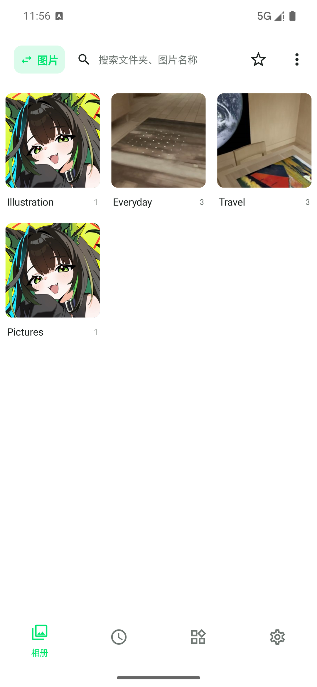
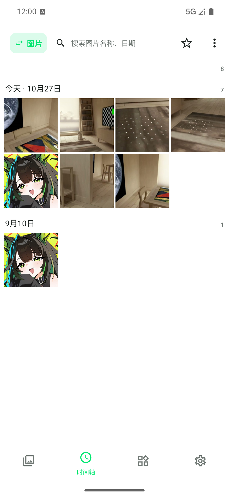
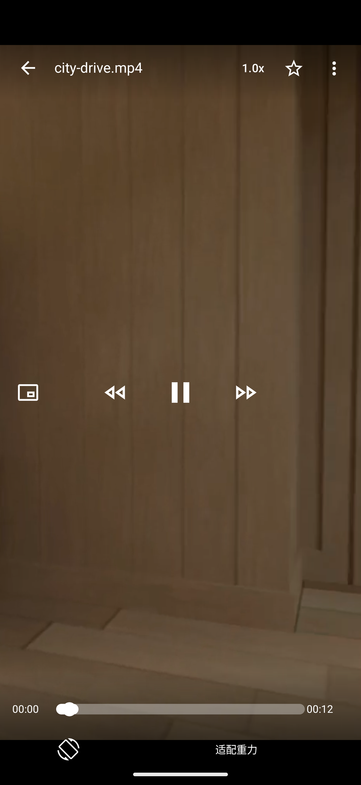
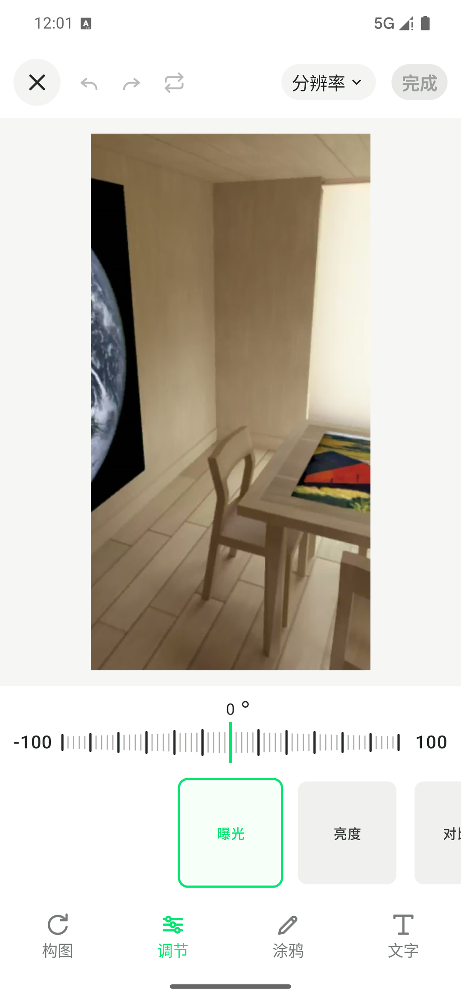

<div align="center">

# Album

**本地优先的 Android 图片、视频与壁纸管理器**

整理、编辑、播放和展示你的媒体，不把图库交给云端。

[](https://github.com/Tnomlav/ALbum/releases)
[](https://github.com/Tnomlav/ALbum/actions/workflows/android.yml)


[下载](#下载) · [功能](#功能) · [构建](#从源码构建) · [隐私](#隐私与权限) · [English overview](#english-overview)

</div>

Album 是一个开源、本地优先的 Android 媒体管理器，使用 Kotlin 与 Jetpack Compose 构建。它把文件夹浏览、时间轴、批量整理、图片编辑、视频播放、回收站和壁纸队列放进同一套工具里；扫描、排序、编辑、播放与缩略图缓存默认都在设备上完成。

## 截图

<table>
  <tr>
    <td align="center"><a href="docs/screenshots/library.png"></a><br><sub>相册与文件夹</sub></td>
    <td align="center"><a href="docs/screenshots/timeline.png"></a><br><sub>时间轴</sub></td>
    <td align="center"><a href="docs/screenshots/video-player.png"></a><br><sub>视频播放</sub></td>
    <td align="center"><a href="docs/screenshots/editor.png"></a><br><sub>图片编辑</sub></td>
  </tr>
</table>

## 为什么是 Album

- **媒体留在本机。** 不要求注册账号，不提供云端相册，也不接入分析或广告 SDK。
- **从浏览到整理是一套完整流程。** 可以按文件夹、相册或时间轴查看，批量复制、移动、重命名和删除，并用回收站降低误删风险。
- **为实际使用补齐细节。** 收藏会跟随文件改名和移动；导入导出覆盖收藏、队列、排除文件夹与偏好设置。

## 功能

**浏览与整理**

- 图片和视频按文件夹、相册、时间轴浏览，支持搜索、排序、收藏和多选
- 使用 MediaStore 与 Storage Access Framework 复制、移动、重命名和删除媒体
- 回收站保留期、重复图片检测、文件夹排除
- 接收其他应用的“分享到 Album”，导入时选择目标文件夹

**编辑与播放**

- 图片裁剪、旋转、翻转、曝光与色彩调节、滤镜、涂鸦和文字
- 保存编辑副本或替换原图，保存前明确确认
- Media3 视频播放、播放进度记忆、后台播放、画中画与小窗
- AVI 等格式可通过 LibVLC 兼容路径播放，支持手势跳转和播放控制

**壁纸与展示**

- 静态与动态壁纸队列、裁剪、轮播和低功耗模式
- 幻灯片队列与显示设置
- 深浅色主题、强调色、中文和英文界面

**可选工具**

- Pixiv 登录后按作品、画师与 Tag 归档本地图片
- 开源许可可在应用内离线查看

## 下载

前往 [GitHub Releases](https://github.com/Tnomlav/ALbum/releases) 获取已发布的 APK、更新清单与校验信息。安装包按 CPU 架构拆分：

| 文件 | 适用设备 |
| --- | --- |
| `arm64-v8a` | 大多数近年的 Android 手机和平板 |
| `armeabi-v7a` | 32 位 ARM 设备 |
| `x86_64` | Android 模拟器 |

APK、更新清单和校验文件都通过 Releases 分发，不提交到 Git 仓库。

## 从源码构建

运行构建需要 JDK 17 和 Android SDK；也可以直接用 Android Studio 打开仓库。

```bash
git clone https://github.com/Tnomlav/ALbum.git
cd ALbum
./gradlew testDebugUnitTest lintDebug assembleDebug
```

Windows PowerShell：

```powershell
.\gradlew.bat testDebugUnitTest lintDebug assembleDebug
```

Debug APK 位于 `app/build/outputs/apk/debug/`。项目默认按 ABI 拆分；需要单个全架构包时加上 `-PalbumUniversalApk=true`。

Release 签名通过本机 Gradle 属性提供，不要提交 keystore 或密码：

```text
ALBUM_STORE_FILE
ALBUM_STORE_PASSWORD
ALBUM_KEY_ALIAS
ALBUM_KEY_PASSWORD
```

版本号以 [`version.properties`](version.properties) 为唯一来源。完整发布步骤见 [RELEASING.md](RELEASING.md)。

## 隐私与权限

Album 的本地媒体扫描、排序、编辑、播放、收藏和缩略图缓存默认都在设备上完成。App 不提供云端媒体同步，也不接入统计或广告服务。

Pixiv 归档是可选功能：只有主动使用时会连接 Pixiv 读取公开作品信息。请遵守 Pixiv 的服务条款、版权要求和所在地法律。

应用只在对应功能需要时请求媒体或文件夹权限。移动、复制和归档能力受 Android 版本、目标目录和应用权限策略影响。安全问题请按 [SECURITY.md](SECURITY.md) 私下报告。

## 项目状态

- 当前功能范围、已知短板和验收标准见 [产品成熟度复盘](docs/product-readiness-review.md)
- 每个版本的改动记录见 [CHANGELOG.md](CHANGELOG.md)
- 第三方组件与许可证见 [THIRD_PARTY_NOTICES.md](THIRD_PARTY_NOTICES.md)

## 贡献

欢迎提交 Issue 和 Pull Request。提交前请至少运行：

```bash
./gradlew testDebugUnitTest lintDebug
```

界面和行为改动请附复现步骤、设备版本与截图。界面文案统一放在 `ui/AppLanguage.kt` 的字典中，新增中文文案时请同时补英文；关键逻辑请配单元测试。

## English overview

Album is a local-first, open-source Android photo and video manager built with Kotlin and Jetpack Compose. It combines folder browsing, a timeline, batch organization, photo editing, video playback, a recycle bin, wallpaper queues, and optional Pixiv archiving in one app. Media processing stays on the device; Album has no cloud gallery, analytics, or advertising SDK. See [Releases](https://github.com/Tnomlav/ALbum/releases) for builds and [RELEASING.md](RELEASING.md) for the release workflow.

## License

Album is released under the [MIT License](LICENSE).
